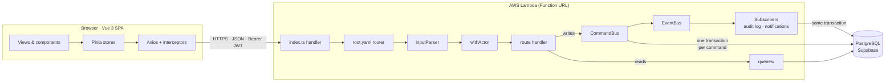
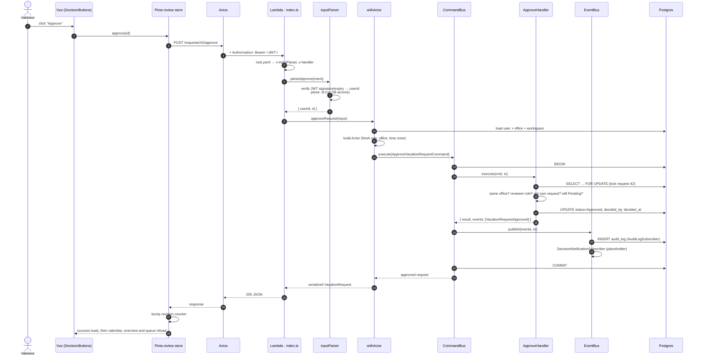
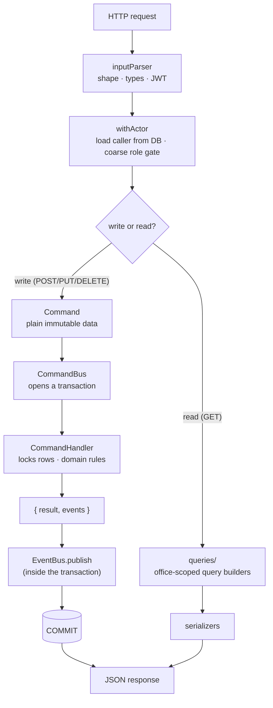
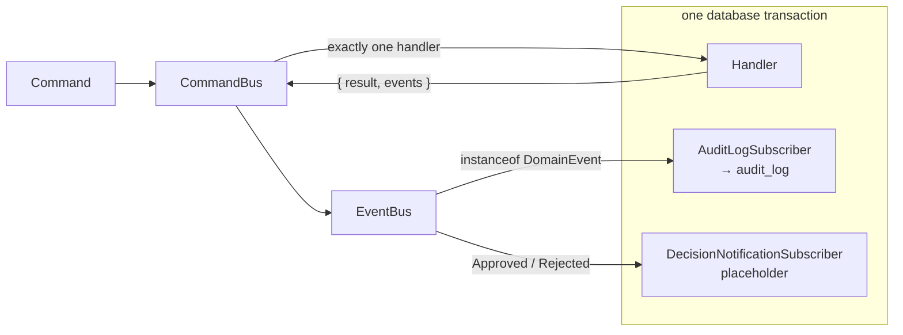
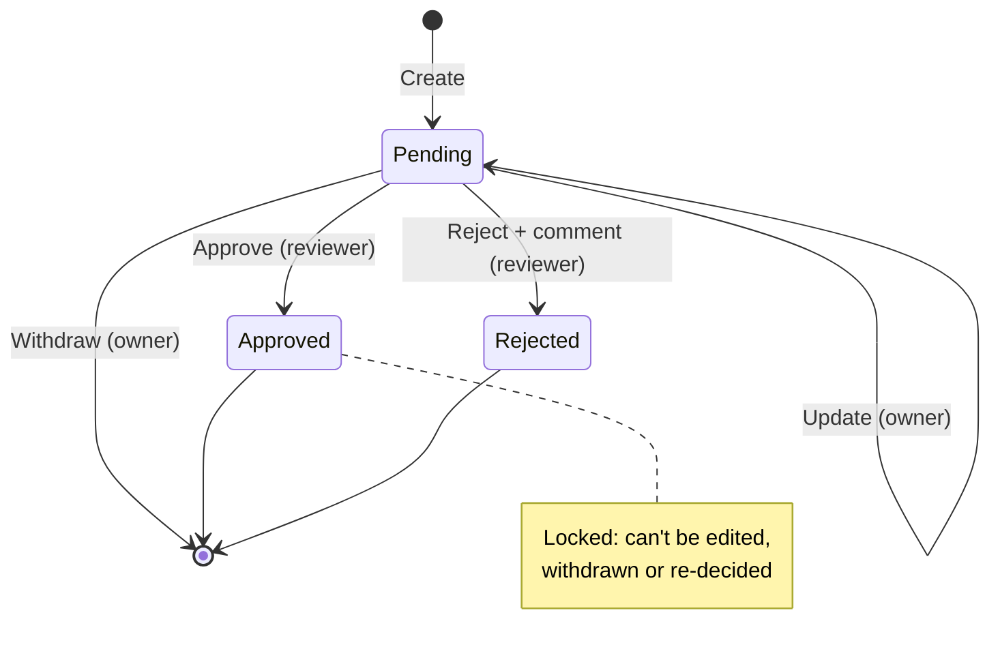
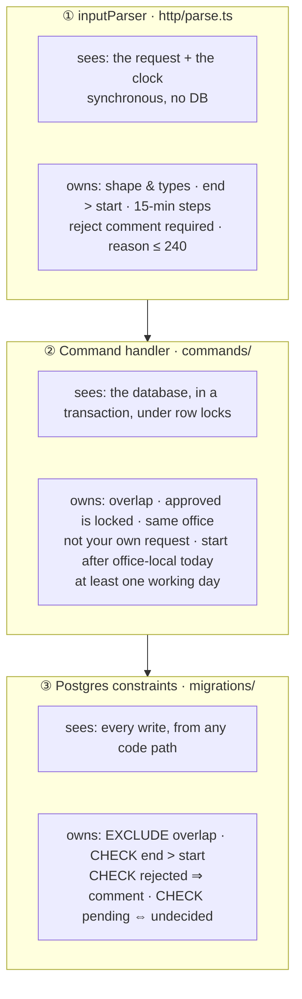
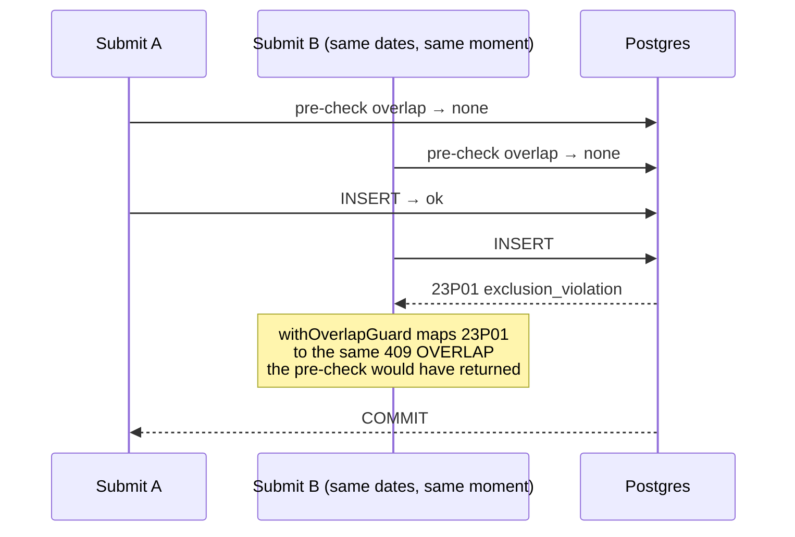
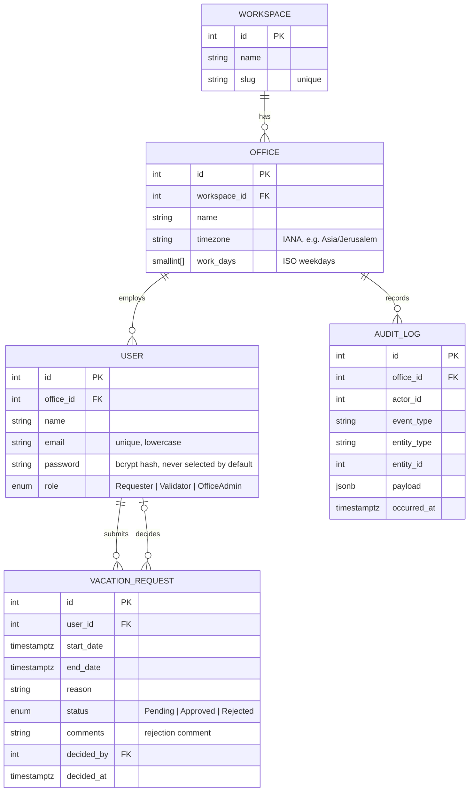
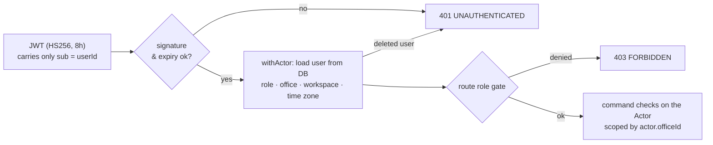
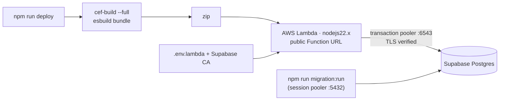

# Offday

**Vacation requests without the email thread.** Employees submit time off, validators approve or reject it,
and office admins run their offices' calendars, all scoped to a multi-tenant workspace.

The backend is the heart of the project: a command/event architecture on AWS Lambda, where every business rule
is enforced at the layer that can actually see the truth, down to a Postgres exclusion constraint that makes
overlapping vacations impossible even under concurrent writes.

| | |
|---|---|
| **Backend** | Node.js 22, TypeScript, [commoneventframework](https://www.npmjs.com/package/commoneventframework) (local server + AWS Lambda), TypeORM, PostgreSQL (Supabase), Zod, luxon, JWT |
| **Frontend** | Vue 3 (`<script setup>`, TypeScript), Vite, Vue Router, Pinia, Axios, VeeValidate + Zod, Tailwind CSS, luxon |
| **Tests** | Vitest: unit tests for time math and holiday parsing, plus an end-to-end suite against a real Postgres |

---

## Contents

1. [Quick start](#quick-start)
2. [Architecture at a glance](#architecture-at-a-glance)
3. [The life of a request: data flow](#the-life-of-a-request-data-flow)
4. [Commands, events and transactions](#commands-events-and-transactions)
5. [Where each business rule lives](#where-each-business-rule-lives)
6. [Concurrency: why overlaps can't happen](#concurrency-why-overlaps-cant-happen)
7. [Data model](#data-model)
8. [Security and tenancy](#security-and-tenancy)
9. [Errors](#errors)
10. [Time zones](#time-zones)
11. [Frontend](#frontend)
12. [Deployment](#deployment)
13. [Testing](#testing)
14. [Project layout](#project-layout)
15. [Known limitations](#known-limitations)

---

## Quick start

Requires **Node 22+** and **Docker** (for the local Postgres).

```bash
# 1. Database
docker compose up -d                 # Postgres 17 on localhost:5433

# 2. API
cd backend
npm install
cp .env.example .env                 # points at the docker Postgres; set JWT_SECRET
npm run db:setup                     # run migrations + seed demo data
npm run dev                          # http://localhost:8888

# 3. Web app (second terminal)
cd frontend
npm install
cp .env.example .env                 # VITE_API_URL=http://localhost:8888
npm run dev                          # http://localhost:5173
```

### Demo accounts

All passwords are `demo1234`. The login screen has a one-click card for each.

| Name | Email | Role | Office |
|---|---|---|---|
| Lina Haddad | `lina@acme.io` | Requester | Acme · Tel Aviv (`Asia/Jerusalem`, Sun–Thu) |
| Omar Benali | `omar@acme.io` | Validator | Acme · Tel Aviv |
| Noa Levi | `noa@acme.io` | OfficeAdmin | Acme · Tel Aviv |

The seed also creates the rest of the Tel Aviv team, an **Acme · Paris** office (`Europe/Paris`), and a separate
**Globex** workspace with a Montreal office (`America/Toronto`), so tenant isolation can be seen and tested.

### Scripts

| Backend (`backend/`) | |
|---|---|
| `npm run dev` | Local API server (same handler as Lambda) |
| `npm run db:setup` | `migration:run` + `seed` |
| `npm run typecheck` | `tsc --noEmit` |
| `npm test` | Unit tests |
| `npm run test:e2e` | End-to-end suite (spins up its own API against the local Postgres) |
| `npm run deploy` | Build and deploy to AWS Lambda (see [Deployment](#deployment)) |

| Frontend (`frontend/`) | |
|---|---|
| `npm run dev` | Vite dev server |
| `npm run build` | Type check (`vue-tsc`), then production build to `dist/` |
| `npm test` | Unit tests (form validation) |

---

## Architecture at a glance



The same `index.ts` handler runs as the local dev server and as the Lambda. Routing is declared in
[`backend/src/root.yaml`](backend/src/root.yaml), an OpenAPI 3 document that is **both the API documentation and
the router**: each operation names its `x-inputParser` and `x-handler`, so the docs can't drift from the code.

---

## The life of a request: data flow

Here is everything that happens when a validator clicks **Approve**, from the click to the toast.



If anything throws at any step (a bad token, a 409 because another validator decided first, a failing subscriber),
the transaction rolls back **as a whole** and the error is mapped to the [error contract](#errors) in one place.

### Write path vs. read path (CQRS-lite)



Writes go through the bus because they need transactions, locks and events. Reads skip it: pushing a `SELECT`
through a command bus adds ceremony without any guarantee. Read models are shaped for the UI (for example, the review
queue returns its status counts and `awaitingMyReview` in the same response, so the UI never makes N extra calls).

---

## Commands, events and transactions

| Command | Emits | Who |
|---|---|---|
| `CreateVacationRequestCommand` | `VacationRequestCreated` | anyone, for themselves |
| `UpdateVacationRequestCommand` | `VacationRequestUpdated` | owner, Pending only |
| `WithdrawVacationRequestCommand` | `VacationRequestWithdrawn` | owner, Pending only |
| `ApproveVacationRequestCommand` | `VacationRequestApproved` | Validator / OfficeAdmin, same office, not own |
| `RejectVacationRequestCommand` | `VacationRequestRejected` | Validator / OfficeAdmin, with a comment |
| `ChangeUserRoleCommand` | `UserRoleChanged` | OfficeAdmin, same workspace, not own role |
| `UpdateOfficeTimezoneCommand` | `OfficeTimezoneChanged` | OfficeAdmin, same workspace |
| `UpdateOfficeWorkWeekCommand` | `OfficeWorkWeekChanged` | OfficeAdmin, same workspace |

Three design choices make this layer predictable:

- **Handlers don't publish.** They return `{ result, events }`. The handler describes *what happened*; the bus
  decides *when it becomes visible*. That makes handlers easy to test and keeps publishing consistent.
- **One transaction per command, events included.** `AuditLogSubscriber` subscribes to the base `DomainEvent`
  class, so every event is written to `audit_log` atomically with the change. The audit trail can't disagree with
  the data.
- **An explicit composition root.** [`backend/src/app.ts`](backend/src/app.ts) wires every handler and subscriber in
  one file, with no decorators or auto-discovery. Registering a second handler for the same command throws.



**The deliberate boundary: side effects.** A real email or push must *not* run inside that transaction: a slow
provider would hold row locks, a failed send would undo a valid decision, and a rolled-back decision could still have
sent an email. That's why `DecisionNotificationSubscriber` is only a placeholder. The production design is a
**transactional outbox** (write the message in the same transaction, deliver it after commit, with retries). The
`EventBus` interface already allows an async transport such as SQS or EventBridge without changing any handler.

### Request lifecycle



---

## Where each business rule lives

"Validate input" is too vague. A rule can only be enforced where its inputs are trustworthy, so each rule sits at
the layer that can see the truth:



| # | Rule | Enforced at |
|---|---|---|
| 1 | End must be after start (same-day partial requests allowed) | inputParser + `CHECK` |
| 2 | No overlap with the user's own Pending/Approved requests | handler pre-check + `EXCLUDE` constraint |
| 3 | Approved requests can't be modified | handler, after `SELECT … FOR UPDATE` |
| 4 | No requests in the past (start after *office-local* today) | handler (needs the office zone from the DB) |
| 5 | Rejecting requires a comment | inputParser + `CHECK` |
| 6 | Only validators decide, within their office, never their own | route role gate + handler |

The guiding question isn't "can the client tamper with this layer?" (the inputParser runs on the server). It is
**"does this check rely on a client's claim about server state?"** For example, "approved can't be modified" can't
trust an `isApproved` flag from the client; it must read the row, under a lock.

The UI mirrors these rules for instant feedback, but the API is always the authority.

---

## Concurrency: why overlaps can't happen

"No overlapping requests" is a classic race. Two concurrent submissions both run `SELECT … overlapping`, both see
nothing, and both insert. A row lock can't help, because the conflicting row doesn't exist yet. So the database
owns the invariant:

```sql
CONSTRAINT vacation_no_overlap EXCLUDE USING gist (
  user_id WITH =,
  tstzrange(start_date, end_date, '[)') WITH &&
) WHERE (status <> 'Rejected')
```



- `btree_gist` lets one GiST index combine `=` on `user_id` with range overlap `&&`.
- Ranges are **half-open** `[start, end)`: a request ending at 13:00 and one starting at 13:00 don't overlap, so a
  morning off and an afternoon off can coexist.
- The partial `WHERE` means rejected requests never block new ones.
- The handler's pre-check exists only to return a helpful `409` with `details.conflict`. The client can't tell which
  layer caught it. The e2e suite fires two identical submissions at once and asserts exactly one survives.

State transitions on existing rows (approve, reject, edit, withdraw, role and office changes) use
`SELECT … FOR UPDATE`. Two validators deciding the same request are serialized, and the second gets
`409 INVALID_STATE`.

---

## Data model



- The schema is owned by versioned TypeORM migrations (`synchronize: false`), never by the ORM's auto-sync.
- Roles and statuses are Postgres `ENUM`s. Indexes follow the access paths: `(user_id, start_date DESC)` for
  "my requests" and overlap checks, `status` for the queue, `(office_id, occurred_at DESC)` for the audit log.
- Periods are `timestamptz` on 15-minute steps rather than dates, so half days work. A request inside one working day
  that lasts under 6 hours counts as **0.5** day; the day count is always computed by the server.

---

## Security and tenancy



- **The token carries identity only.** Permissions are reloaded from the database on every request, so a demotion
  or deletion takes effect **immediately**, even for a token that is still valid. The cost is one primary-key lookup.
- **Tenancy comes from the caller, never from the request.** Every query and command is scoped by
  `actor.officeId` / `actor.workspaceId`, loaded from the DB. Another office's resources answer 403/404, and another
  workspace's always answer 404.
- **The API is the only path to the data.** Supabase's auto-generated Data API is disabled, so no anon-key client can
  skip the business rules. TLS is verified against the Supabase root CA, not just `ssl: true`.
- **Login** returns one generic error for a wrong password or unknown email (no account enumeration). Passwords are
  hashed with bcrypt.

---

## Errors

Every failure, including those raised by the database, has one shape, produced in one place
([`http/respond.ts`](backend/src/http/respond.ts)):

```json
{ "error": { "code": "OVERLAP", "message": "…", "details": { "conflict": { "id": 7, "startDate": "…", "endDate": "…", "status": "Approved" } } } }
```

| Status | `code` | When |
|---|---|---|
| 400 | `VALIDATION_ERROR` | Bad input; `details.fields` maps field → message (worded to match the UI) |
| 401 | `UNAUTHENTICATED` | Missing, invalid or expired token; bad login |
| 403 | `FORBIDDEN` | Role not allowed |
| 404 | `NOT_FOUND` | Missing, or not visible to the caller |
| 409 | `OVERLAP` / `INVALID_STATE` | Overlap (with `details.conflict`), or e.g. deciding an already-decided request |
| 500 | `INTERNAL` | Generic message; details are logged server-side, never returned |

Typed `DomainError` subclasses carry the status and code. Constraint violations are translated into the same
contract (`23P01` → `OVERLAP`), so the database's safety net is invisible to clients.

---

## Time zones

With timestamps, "today", "on Thursday" and "half a day" depend on *where* you are. A validator in Paris reviewing a
Tel Aviv request must see Tel Aviv dates, so the **office** time zone, not the browser's, is the single source of truth.

- The API stores and returns UTC. The client sends ISO strings with an explicit offset.
- Display, the date pickers, "after today", working-day detection and day counts are all computed in office time with
  luxon (DST included, verified with mocked clocks).
- Each office has its own **work week** (Tel Aviv works Sun–Thu), set by its OfficeAdmin. Day counts, the calendar's
  weekend shading and "must include a working day" all follow it.
- Time zones are validated and stored in canonical spelling (`europe/paris` → `Europe/Paris`).

---

## Frontend

A Vue 3 single-page app that implements the design in [`docs/design/`](docs/design/) and talks to the API exactly as
described in [`docs/api-contract.md`](docs/api-contract.md).

| Concern | Tool |
|---|---|
| Components & reactivity | Vue 3 Composition API, `<script setup>`, TypeScript |
| Routing & role guards | Vue Router (role meta per route; unauthorized roles are sent to their home page) |
| State | Pinia: `auth`, `myRequests`, `review`, `requestDrawer`, `toasts`, `confirm`, `session` |
| HTTP | Axios with interceptors: adds the token, maps every failure to a typed `ApiError` |
| Forms & validation | VeeValidate + **Zod 4**, mirroring the API rules for instant feedback |
| Dates | luxon, always in the office time zone |
| Styling | Tailwind CSS, with the design tokens in `tailwind.config.ts` |

| Route | Page | Roles |
|---|---|---|
| `/login` | Sign in | public |
| `/requests/mine` | My requests (balance, next time off, history) | all |
| `/team` | Team calendar (with religious holidays for reviewers) | all |
| `/dashboard` | Overview KPIs and monthly chart | Validator, OfficeAdmin |
| `/requests` | Review queue: filters, pagination, approve / reject | Validator, OfficeAdmin |
| `/admin/users` | Users & roles | OfficeAdmin |
| `/admin/office` | Office time zones and work weeks | OfficeAdmin |

### Challenges worth mentioning

- **One Zod version on both sides (a deliberate decision).** The backend validates with Zod 4, but
  `@vee-validate/zod` only supports Zod 3. Rather than run two major versions with different APIs and error shapes,
  we wrote a small adapter ([`validation/zodTypedSchema.ts`](frontend/src/validation/zodTypedSchema.ts)) that implements
  VeeValidate's `TypedSchema` interface on top of Zod 4. Frontend and backend schemas now share one version, one
  syntax and one error model, and there is one dependency fewer to keep in sync.
- **Role changes while signed in.** Because the API reloads permissions per request, an admin can demote someone
  mid-session. The client refetches `/me` on a 403, on window focus and on navigation, re-runs the route guards and
  explains what changed, instead of leaving stale nav items that lead to 403s.
- **No server push on Lambda.** Function URLs don't hold sockets, so the stores bump a `revision` counter after each
  change, and open views (calendar, overview, queue) watch it and reload.
- **Errors in one place.** The response interceptor turns every failure into an `ApiError`: 401 ends the session,
  field errors map onto form inputs, a 409 `OVERLAP` names the conflicting request, and everything else raises a toast.
- **Accessible dialogs.** A shared `useDialog` composable handles the focus trap, Escape and focus restore for the
  request drawer, the reject modal and confirmations.

---

## Deployment



1. Copy `backend/.env.lambda.example` to `backend/.env.lambda` and fill in the Supabase **transaction pooler** URL.
2. Run the migrations and seed against Supabase from your machine (`DATABASE_URL` set to the **session pooler**).
3. `npm run deploy` (requires AWS CLI credentials) builds the bundle, creates or updates the function and its
   Function URL, and prints the URL. Set it as `VITE_API_URL` for the frontend build.

Serverless-specific choices:

- **Connections:** Lambda uses Supabase's transaction pooler, because many short-lived containers would exhaust
  direct connections. The pool size comes from `DB_POOL_MAX`: 2 on Lambda (one request per container), 10 locally.
- **The DataSource is created lazily** and reused across warm invocations; env vars are read at call time because
  CEF's `loadEnv()` is async.
- **`pg` is imported statically** so esbuild bundles it (TypeORM's own `require` is dynamic).
- CORS preflight is answered in the handler, and CEF's debug routes are disabled on Lambda.

---

## Testing

```bash
cd backend
npm test            # unit: office time math (DST, work weeks, half days), iCalendar holiday parsing
npm run test:e2e    # end-to-end: real API + real Postgres
cd ../frontend
npm test            # request form validation
```

The e2e suite migrates and reseeds a disposable database, starts the API, and exercises it over HTTP: every business
rule, concurrent duplicate submissions, RBAC for all three roles, role changes applying to existing tokens, office and
workspace isolation, and the read models. It refuses to run against a non-local database host.

---

## Project layout

```
backend/
  src/
    index.ts          Lambda / dev-server entry: routing, CORS preflight, error mapping
    root.yaml         OpenAPI 3 spec = the router (x-inputParser / x-handler)
    app.ts            Composition root: commands → handlers, events → subscribers
    core/             CommandBus, EventBus, DomainEvent, typed errors
    http/             parse.ts (Zod, JWT), withActor.ts, respond.ts (error contract)
    auth/             JWT tokens, Actor, loadActor
    commands/         vacation/ and office/ commands + handlers, shared rules
    events/           domain events and subscribers
    queries/          read models and serializers
    domain/           TypeORM entities, enums, officeTime (luxon)
    holidays/         Google public holiday calendars (iCalendar) with caching
    db/               DataSource, migrations, seed
  tests/e2e/          end-to-end suite
  scripts/deploy.mjs  Lambda deployment
frontend/
  src/
    api/              Axios instance, ApiError, typed endpoint functions
    stores/           Pinia stores
    router/           routes, role meta, guards
    components/       ui/, layout/, requests/, calendar/, overview/, admin/
    views/            pages
    validation/       Zod schemas and the VeeValidate adapter
docs/
  api-contract.md     shared contract between backend and frontend
  design/             design handoff and HTML prototype
decisions.md          architecture decision records
```

The reasoning behind every major choice (with alternatives and costs) is in **[decisions.md](decisions.md)**.

---

## Known limitations

| Limitation | Next step |
|---|---|
| Notifications are a logging placeholder | Transactional outbox and a delivery worker |
| Sign-out doesn't revoke the token (privilege changes already apply immediately) | `tokenVersion` column on `users` |
| No login rate limiting | Throttling per IP and per account |
| No live updates for other users | WebSocket API, or polling a lightweight "revision" endpoint |
| Offset pagination | Keyset pagination if the review queue grows large |
